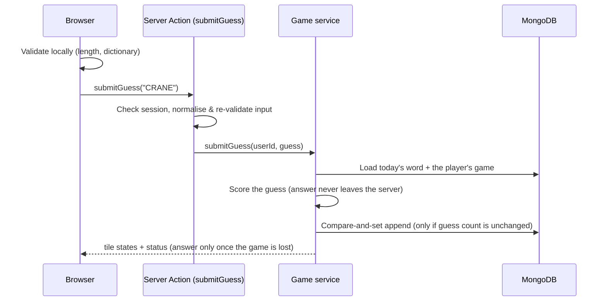

# Guess the Word

A Wordle-style daily word puzzle built with **Next.js 16**, **Auth.js v5**, **MongoDB** and **Redis**.
Pick a name, get six tries to find the hidden five-letter word, and see how you rank on today's leaderboard.

[](https://github.com/AmineGuitouni/wordle-clone/actions/workflows/ci.yml)

<table>
  <tr>
    <td></td>
    <td></td>
  </tr>
  <tr>
    <td></td>
    <td></td>
  </tr>
</table>

## Features

- **Daily puzzle** with the classic green / yellow / grey feedback, correct handling of duplicate letters, an on-screen
  keyboard that tracks letter states, and physical-keyboard support.
- **Guest accounts** — choose a display name and play; no email or password. Your browser keeps a signed device
  identity, so changing your name never gives you a fresh game.
- **Passkeys to play on other devices** — save a passkey (Face ID, Touch ID, Windows Hello, your phone) and sign back in
  as the same player anywhere, still without an email, a password or anything to remember.
- **A leaderboard that is hard to game** — a fresh identity can't rank on the word that is already live, and an unused
  spare identity can't rank on a network where someone already finished it (see
  [Who counts on the leaderboard](#who-counts-on-the-leaderboard)).
- **Abuse protection** — a self-hosted proof-of-work challenge before a new identity is issued, escalating per-IP
  limits, and per-player rate limiting on guesses (see [Identity & abuse protection](#identity--abuse-protection)).
- **Daily leaderboard** ranked by a score that rewards fewer tries and faster solves.
- **Polished UI** — flip / pop / shake / bounce tile animations (plus a ripple while the server checks a slow guess), light and dark themes, a how-to-play dialog,
  shareable emoji results, a layout that fits the screen without scrolling from 320 px phones (portrait and landscape) to 1440p monitors, and
  `prefers-reduced-motion` support.
- **Accessible** — ARIA grid semantics for the board, labelled keys, live-region messages, visible focus states.

## Tech stack

| Area      | Choice                                                                                |
| --------- | ------------------------------------------------------------------------------------- |
| Framework | Next.js 16 (App Router, Server Components, Server Actions, `proxy.ts`), React 19      |
| Auth      | Auth.js v5 (guest credentials provider, stateless JWT sessions)                       |
| Database  | MongoDB (official driver, lazy singleton connection, index bootstrap)                 |
| Cache     | Redis via `ioredis` behind a reusable `Cache` service (retries, circuit breaker)      |
| UI        | Tailwind CSS 3, HeroUI, Framer Motion, CSS keyframe animations, `next/font`           |
| Quality   | TypeScript (strict), ESLint, Prettier, Vitest (unit + MongoDB integration), GitHub CI |

## How it works



- **The answer never reaches the client while a game is in progress.** The page is rendered on the server and only
  receives guesses and their computed tile states. A lost game is the only time the answer is sent.
- **Rules are enforced on the server**, not just in the UI: the six-guess limit, no guesses after a win/loss, and
  dictionary validation. Server Actions are public endpoints, so input is re-validated there.
- **Concurrency-safe writes.** A guess is appended with a compare-and-set on the stored guess count, so parallel or
  replayed requests cannot exceed the attempt limit or overwrite each other. A unique index on
  `(userId, roundId)` makes racing first guesses converge on one game. Both are covered by integration tests.
- **Scoring** lives in [`src/lib/game/rules.ts`](src/lib/game/rules.ts) as pure, unit-tested functions using Wordle's
  two-pass algorithm (greens first, then yellows limited by the remaining count of each letter).
- **Daily rounds.** Each document in the `words` collection is a round (an answer and when it went live); the newest
  is today's. A secured webhook starts the next one (see [Daily word rotation](#daily-word-rotation)), and a brand-new
  database is seeded automatically on first use. Games, leaderboards and network hashes belong to a **round**, not to
  a word, so a word that comes back months later starts everyone on a clean slate. Games saved before rounds were
  tracked are linked to their round automatically when the app starts.
- **Leaderboard score** = `1e9 / (solveTimeMs + 10 000 × tries)`; only players who solved today's word are listed.

## Identity & abuse protection

Guests have no passwords, so the server needs another way to recognise a returning player and to make bulk-creating
fake players expensive. It layers three things:

```mermaid
sequenceDiagram
    participant B as Browser
    participant I as POST /api/identity
    participant R as Redis
    participant A as Auth.js (guest provider)
    B->>I: { name }
    I->>R: per-IP request limit
    alt valid signed device cookie
        I-->>B: ok (same identity; only the display name changes)
    else new browser
        I-->>B: challenge { salt, difficulty, signed token }
        B->>B: solve proof of work in a Web Worker
        B->>I: { name, token, nonce }
        I->>I: verify signature, expiry and hash
        I->>R: mark challenge used (single use) and count the creation for this IP
        I-->>B: ok + Set-Cookie: signed device id (httpOnly, 1 year)
    end
    B->>A: signIn("guest", { name })
    A->>A: authorize: accept only a validly signed device cookie
    A-->>B: session whose user id is the device id
```

- **Device identity.** A random 128-bit id lives in a signed (HMAC-SHA256), `httpOnly`, long-lived cookie, and it _is_
  the player id. The display name is only a label, so signing out and back in under another name resolves to the same
  player, the same game and the same guess count. Only ids the server signed are accepted.
- **Proof of work.** A browser without an identity must find a nonce so that `SHA-256(salt:nonce)` starts with N zero
  bits before one is issued. Challenges are stateless (signed token with salt, difficulty and expiry), single-use
  (replay marker in Redis) and solved in a Web Worker, so no third-party captcha or account is needed. Difficulty starts at 16 bits (`POW_DIFFICULTY_BITS`, about 0.1 s on a laptop) and **doubles for every
  identity the same IP created recently** (up to 64×, about 8 s), so making identities in bulk gets expensive quickly.
- **Rate limits** (fixed windows in Redis): 30 identity requests per IP per 10 minutes, 10 new identities per IP per
  hour, 30 guesses per player per minute, 30 passkey sign-in requests per IP per 10 minutes and 20 passkey registration
  requests per player per hour. Returning devices don't count against the creation limit. A blocked client gets `429`
  with `Retry-After`.

### Passkeys: the same player on every device

An identity is a browser cookie, so on its own it can't follow a player to their phone. Instead of an email address,
players can save a **passkey** from the result panel or the account menu (WebAuthn via
[SimpleWebAuthn](https://simplewebauthn.dev)):

- **Saving** (`/api/passkeys/register/*`, signed-in players only) creates a discoverable credential whose WebAuthn
  user handle is the identity id. Passkey providers sync it (iCloud Keychain, Google Password Manager, 1Password, ...).
- **Signing in** (`/api/passkeys/sign-in/*`, "Use a passkey" on the home page) needs no username: the device offers the
  passkeys it holds for this site. A valid assertion gives the browser the **same** identity cookie (same games,
  history and creation date), then the normal guest sign-in runs.
- **Challenges are stateless and single use**, like the proof of work: the WebAuthn challenge is a signed token naming
  the ceremony, the player (for registration), a nonce and an expiry; a Redis marker spends it once the response
  verifies. Responses are checked against the request's origin and host name, and against the stored public key.
- No user verification (PIN or biometrics) is required: a passkey here replaces a cookie, not a password. Credentials
  are stored in the `passkeys` collection (public key, signature counter, transports).

### Who counts on the leaderboard

Anyone can get a fresh identity by clearing cookies, so the rules make that pointless for climbing the board, without
collecting anything personal ([`src/lib/game/ranking.ts`](src/lib/game/ranking.ts)). A win is **provisional**,
meaning only its player sees it, marked and at the place it would take, when either:

1. **The identity is newer than the word.** "Lose, clear cookies, enter the answer" produces a brand-new identity, so it
   can't rank on the word that is already live. New players rank from the next word.
2. **It is a spare identity on a shared network.** The identity has never finished a game, and another identity on the
   same network has already finished this word. Regulars build up history, so two regulars in one coffee shop (or on
   a mobile carrier's shared address) both rank; an identity made in advance and kept unused does not.

The network is compared through a keyed hash (HMAC of the IPv4 address or IPv6 `/64` prefix, mixed with the round
id), stored per game. Raw IPs are never stored, and hashes from different rounds can't be linked. Identities record
their creation time in the `identities` collection; identities from before that collection existed count as
established.

### Redis cache service

[`src/lib/cache`](src/lib/cache) is a small, reusable layer rather than raw Redis calls scattered around the app:

- A `CacheStore` interface with a Redis driver (`ioredis`) and an in-memory driver. The app uses Redis when `REDIS_URL`
  is set and falls back to memory otherwise (fine for development; not shared between instances in production).
- `Cache` adds key namespacing, JSON values, `getOrSet` (cache-aside with in-process request coalescing), atomic
  windowed counters (a Lua script, so `INCR` + `EXPIRE` can't be split by a crash) and one-time-use markers.
- **Resilience.** Reconnects forever with capped exponential backoff and jitter, per-command timeouts, one quick retry
  for idempotent reads/writes, and a **circuit breaker** so a dead Redis costs one fast failure instead of a timeout on
  every request. Errors are logged at most once per interval.
- **Two error policies.** _Soft_ operations (`get`, `set`, `del`, `getOrSet`) degrade to cache misses, so an outage
  can't break a page. _Strict_ operations (`incr`, `setIfAbsent`) throw `CacheUnavailableError`; the rate limiter and
  challenge check catch it and **fail open** (the game stays playable; the limits just aren't enforced until Redis is
  back).
- What is cached: today's word (60 s, dropped when the word rotates) and the leaderboard ranking (15 s, dropped when a
  game is won or a player renames). Rate-limit counters and used-challenge markers live there too.

## Getting started

Requirements: Node.js 20.9+ and a MongoDB instance (local or [Atlas](https://www.mongodb.com/atlas)).

```bash
git clone https://github.com/AmineGuitouni/wordle-clone.git
cd wordle-clone
npm install
cp .env.example .env.local   # then fill in the values
npm run dev
```

Open <http://localhost:3000>. A throwaway local MongoDB (and optionally Redis) is one command away:

```bash
docker run -d --name guess-the-word-mongo -p 27017:27017 mongo:7
docker run -d --name guess-the-word-redis -p 6379:6379 redis:7   # optional; then set REDIS_URL
```

### Environment variables

| Variable               | Required | Description                                                                      |
| ---------------------- | :------: | -------------------------------------------------------------------------------- |
| `MONGODB_URI`          |    ✅    | MongoDB connection string                                                        |
| `MONGODB_DB`           |    ✅    | Database name                                                                    |
| `AUTH_SECRET`          |    ✅    | Signs sessions, device cookies, challenges and network hashes. `npx auth secret` |
| `WEBHOOK_SECRET_KEY`   |    ✅    | Authorises the daily word rotation webhook                                       |
| `CRON_SECRET`          |  Vercel  | Same value as `WEBHOOK_SECRET_KEY`; Vercel Cron sends it as a bearer token       |
| `REDIS_URL`            |    —     | `redis://` or `rediss://` URL. Without it a per-process in-memory cache is used  |
| `CACHE_NAMESPACE`      |    —     | Key prefix (default `gtw`); lets staging and production share one Redis          |
| `POW_DIFFICULTY_BITS`  |    —     | Base proof-of-work difficulty, 0–28 (default `16`)                               |
| `AUTH_TRUST_HOST`      |    —     | Set to `true` for any production run outside Vercel (`npm start`, Docker, a VPS) |
| `NEXT_PUBLIC_SITE_URL` |    —     | Public site URL for absolute link-preview (Open Graph) URLs; optional on Vercel  |

The app builds without any of these set; they are only read when a request needs them. `AUTH_SECRET` also signs device
identities and proof-of-work challenges, so rotating it signs everyone out and invalidates their device cookies.

> **Production needs a shared Redis.** With several server instances (or serverless functions) the in-memory fallback
> keeps separate counters per instance, which weakens rate limiting and replay protection. Set `REDIS_URL`.

> **Running `npm start` locally or on your own server?** Auth.js refuses unknown hosts in production, so sign-in fails
> with `UntrustedHost` unless you set `AUTH_TRUST_HOST=true`. Vercel configures this automatically.

## Scripts

| Command             | What it does                                          |
| ------------------- | ----------------------------------------------------- |
| `npm run dev`       | Start the dev server                                  |
| `npm run build`     | Production build                                      |
| `npm start`         | Serve the production build                            |
| `npm run lint`      | ESLint                                                |
| `npm run format`    | Prettier (`format:check` verifies without writing)    |
| `npm run typecheck` | Generate Next route types and run `tsc`               |
| `npm test`          | Vitest unit tests (+ integration tests if configured) |
| `npm run check`     | Lint, format check, typecheck and tests in one go     |

## Testing

Unit tests cover the game rules, scoring, validation, the dictionary, the retry helper, the cache service (including
failure modes with a fake failing backend), the rate limiter, and the identity primitives (signatures, device cookie,
proof of work, challenges, client flow).

Integration tests run against real services and are skipped unless configured:

- `TEST_MONGODB_URI` enables the game service (attempt cap, win/loss lifecycle, racing requests, seeding, leaderboard
  and cache invalidation), the `/api/identity` endpoint (challenge, replay, tampering, escalation, rate limits, "rename
  keeps your game") and the guess server action (rate limiting).
- `TEST_REDIS_URL` additionally runs the cache-store contract suite against Redis and points the integration tests at
  it instead of the in-memory cache. Use a spare database index, e.g. `/1`. Each run uses a unique key namespace.

```bash
docker run -d --name guess-the-word-test-mongo -p 27018:27017 mongo:7
docker run -d --name guess-the-word-test-redis -p 6380:6379 redis:7
TEST_MONGODB_URI=mongodb://127.0.0.1:27018 TEST_REDIS_URL=redis://127.0.0.1:6380/1 npm test
```

CI runs everything, with MongoDB and Redis service containers, on every push and pull request.

## Daily word rotation

Call the webhook once a day (cron-job.org, GitHub Actions, Vercel Cron, …) to pick a new word. Both `GET` and `POST`
are accepted, authenticated with either a `key` header or a bearer token:

```bash
curl -X POST https://your-app.example.com/api/webhooks/updatetodaysword \
  -H "key: $WEBHOOK_SECRET_KEY"
```

The new word is never the same as the previous one and, until all ~1 000 words have had a turn, never a word that was
used before. Everyone starts a fresh game.

**On Vercel** the schedule is already configured in [`vercel.json`](vercel.json): a `GET` to the webhook every day at
00:00 UTC. Vercel Cron authenticates with `Authorization: Bearer $CRON_SECRET`, so set `CRON_SECRET` to the same value
as `WEBHOOK_SECRET_KEY`. Crons only run on production deployments. On the Hobby plan a job may run once a day and fires
at some point within the hour (not exactly at 00:00), and delivery is best effort, so a missed run simply keeps
yesterday's word until the next one.

## Deploying

1. Create a MongoDB Atlas cluster and allow your host's IPs.
2. Create a Redis instance (e.g. Upstash or Redis Cloud) and use its `rediss://` URL as `REDIS_URL`.
3. Import the repository into Vercel (or any Node host) and set the environment variables above.
4. On Vercel the rotation cron comes from `vercel.json`; set `CRON_SECRET` equal to `WEBHOOK_SECRET_KEY`. Elsewhere,
   schedule a call to the webhook yourself.
5. Settle on the production domain before players save passkeys: passkeys only work on the domain (and its
   subdomains) they were created on, and they require HTTPS (or `localhost` during development).

## Project structure

```
src/
├── app/                  Routes: landing, /game (+ server action), /leaderboard, auth, identity, passkey, webhook APIs
├── components/
│   ├── game/             Board, tiles, keyboard, result panel, how-to-play dialog, useWordle hook
│   ├── landing/ layout/  Landing demo board, navbar, theme toggle
│   └── auth/ leaderboard/
├── lib/
│   ├── game/             rules · score · words (pure, tested) and service (MongoDB + cache, server-only)
│   ├── cache/            CacheStore contract, Redis + in-memory drivers, the resilient Cache service
│   ├── game/ranking.ts   Who counts on the leaderboard (pure, tested)
│   ├── identity/         Device cookie, signing, proof of work, passkeys (WebAuthn), identity records, client flows
│   ├── db.ts             Lazy MongoDB client, typed collections, index bootstrap
│   ├── rate-limit.ts     Fixed-window limiter and the app's policies
│   ├── retry.ts          Exponential backoff with jitter (also drives Redis reconnects)
│   └── validation.ts     Guest-name rules shared by the form and the server
├── auth.config.ts        Edge-safe Auth.js config shared with proxy.ts
└── proxy.ts              Route protection (Next.js 16 replacement for middleware)
```

## Known limitations & ideas

- The dictionary is small (~1 000 words) and doubles as the answer pool; separating "valid guesses" from "possible
  answers" would make the game more forgiving.
- **No anonymous scheme can truly identify a person.** The identity belongs to a browser (or to whoever holds its
  passkey): clearing cookies, using a private window or another device without the passkey yields a new player. The
  ranking rules stop that from paying off on the current word, and the proof of work and per-IP limits make it costly
  in bulk. What remains is deliberate effort: spare identities created in advance, given history by playing them every
  day, and used from different networks (a VPN). Only real accounts would stop that.
- The spare-identity check runs when a game finishes, so two spare identities on one network that finish at the same
  moment can both rank. The check also relies on the client IP (see below).
- Passkeys are bound to the domain they were created on. Moving the app to a new domain (or using a preview URL)
  means passkeys saved on the old one won't work there.
- IP-based limits rely on `x-forwarded-for` / `x-real-ip`, which are only trustworthy behind a proxy that sets them
  (Vercel and similar do). Players sharing one IP (a school, an office) share the creation allowance.
- Rate limiting and replay protection **fail open** when Redis is unreachable, so the game stays playable. Use
  `consumeRateLimit(..., { failOpen: false })` where blocking is preferable.
- Streaks and long-term stats would be a natural next step now that identities can move between devices; they would
  also make an identity more valuable to keep, which deters re-rolling further.
