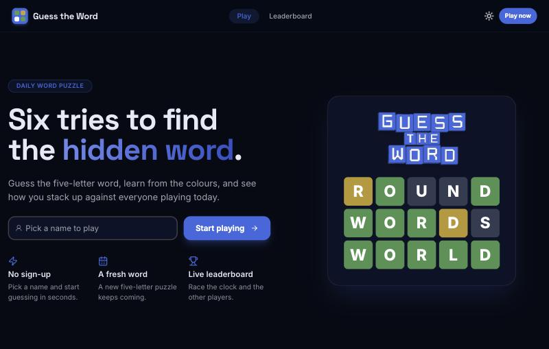
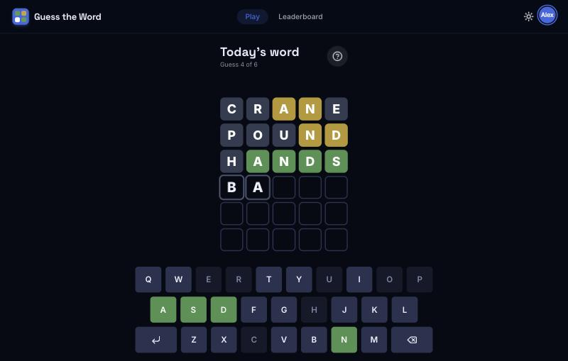
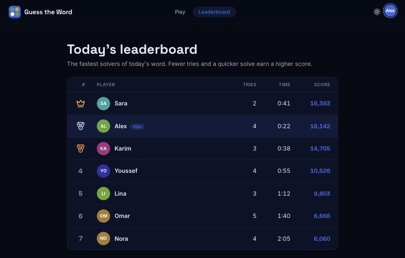
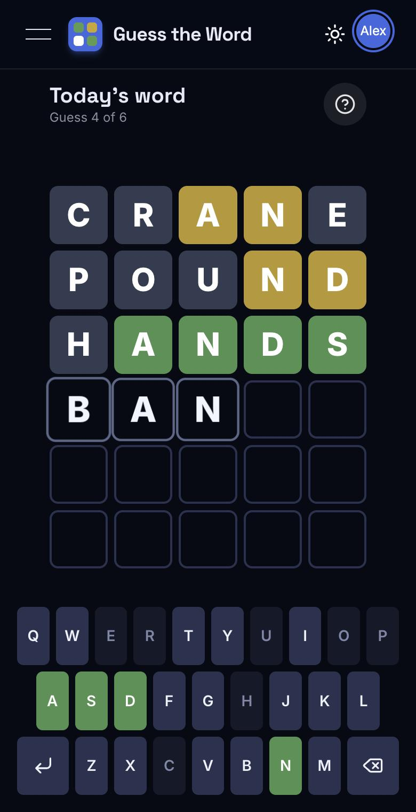
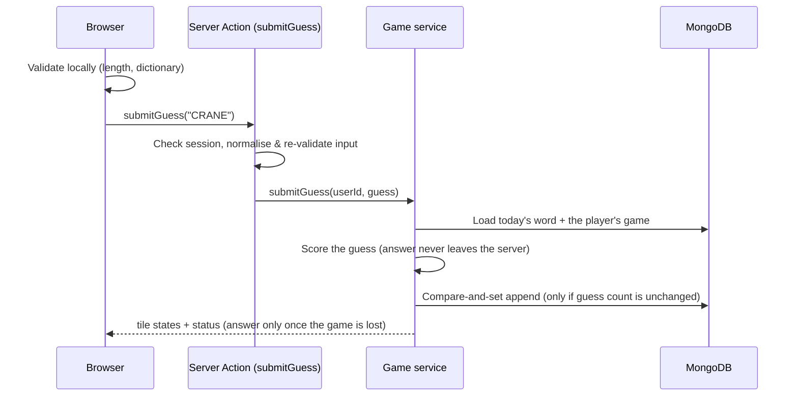

# Guess the Word

A Wordle-style daily word puzzle built with **Next.js 16**, **Auth.js v5** and **MongoDB**.
Pick a name, get six tries to find the hidden five-letter word, and see how you rank on today's leaderboard.

[](https://github.com/AmineGuitouni/wordle-clone/actions/workflows/ci.yml)

<table>
  <tr>
    <td></td>
    <td></td>
  </tr>
  <tr>
    <td></td>
    <td></td>
  </tr>
</table>

## Features

- **Daily puzzle** with the classic green / yellow / grey feedback, correct handling of duplicate letters, an on-screen
  keyboard that tracks letter states, and physical-keyboard support.
- **Guest accounts** — choose a display name and play; no email or password.
- **Daily leaderboard** ranked by a score that rewards fewer tries and faster solves.
- **Polished UI** — flip / pop / shake / bounce tile animations, light and dark themes, a how-to-play dialog,
  shareable emoji results, a responsive layout that fits the viewport on phones, and `prefers-reduced-motion` support.
- **Accessible** — ARIA grid semantics for the board, labelled keys, live-region messages, visible focus states.

## Tech stack

| Area      | Choice                                                                                |
| --------- | ------------------------------------------------------------------------------------- |
| Framework | Next.js 16 (App Router, Server Components, Server Actions, `proxy.ts`), React 19      |
| Auth      | Auth.js v5 (guest credentials provider, stateless JWT sessions)                       |
| Database  | MongoDB (official driver, lazy singleton connection, index bootstrap)                 |
| UI        | Tailwind CSS 3, HeroUI, Framer Motion, CSS keyframe animations, `next/font`           |
| Quality   | TypeScript (strict), ESLint, Prettier, Vitest (unit + MongoDB integration), GitHub CI |

## How it works



- **The answer never reaches the client while a game is in progress.** The page is rendered on the server and only
  receives guesses and their computed tile states. A lost game is the only time the answer is sent.
- **Rules are enforced on the server**, not just in the UI: the six-guess limit, no guesses after a win/loss, and
  dictionary validation. Server Actions are public endpoints, so input is re-validated there.
- **Concurrency-safe writes.** A guess is appended with a compare-and-set on the stored guess count, so parallel or
  replayed requests cannot exceed the attempt limit or overwrite each other. A unique index on
  `(userId, toDaysWord)` makes racing first guesses converge on one game. Both are covered by integration tests.
- **Scoring** lives in [`src/lib/game/rules.ts`](src/lib/game/rules.ts) as pure, unit-tested functions using Wordle's
  two-pass algorithm (greens first, then yellows limited by the remaining count of each letter).
- **Daily word.** The newest document in the `words` collection is today's word. A secured webhook rotates it (see
  [Daily word rotation](#daily-word-rotation)); a brand-new database is seeded automatically on first use.
- **Leaderboard score** = `1e9 / (solveTimeMs + 10 000 × tries)`; only players who solved today's word are listed.

## Getting started

Requirements: Node.js 20.9+ and a MongoDB instance (local or [Atlas](https://www.mongodb.com/atlas)).

```bash
git clone https://github.com/AmineGuitouni/wordle-clone.git
cd wordle-clone
npm install
cp .env.example .env.local   # then fill in the values
npm run dev
```

Open <http://localhost:3000>. A throwaway local MongoDB is one command away:

```bash
docker run -d --name guess-the-word-mongo -p 27017:27017 mongo:7
```

### Environment variables

| Variable               | Required | Description                                                                         |
| ---------------------- | :------: | ----------------------------------------------------------------------------------- |
| `MONGODB_URI`          |    ✅    | MongoDB connection string                                                           |
| `MONGODB_DB`           |    ✅    | Database name                                                                       |
| `AUTH_SECRET`          |    ✅    | Signs session cookies. Generate with `npx auth secret` or `openssl rand -base64 33` |
| `WEBHOOK_SECRET_KEY`   |    ✅    | Authorises the daily word rotation webhook                                          |
| `AUTH_TRUST_HOST`      |    —     | Set to `true` for any production run outside Vercel (`npm start`, Docker, a VPS)    |
| `NEXT_PUBLIC_SITE_URL` |    —     | Public site URL for absolute link-preview (Open Graph) URLs; optional on Vercel     |

The app builds without any of these set; they are only read when a request needs them.

> **Running `npm start` locally or on your own server?** Auth.js refuses unknown hosts in production, so sign-in fails
> with `UntrustedHost` unless you set `AUTH_TRUST_HOST=true`. Vercel configures this automatically.

## Scripts

| Command             | What it does                                          |
| ------------------- | ----------------------------------------------------- |
| `npm run dev`       | Start the dev server                                  |
| `npm run build`     | Production build                                      |
| `npm start`         | Serve the production build                            |
| `npm run lint`      | ESLint                                                |
| `npm run format`    | Prettier (`format:check` verifies without writing)    |
| `npm run typecheck` | Generate Next route types and run `tsc`               |
| `npm test`          | Vitest unit tests (+ integration tests if configured) |
| `npm run check`     | Lint, format check, typecheck and tests in one go     |

## Testing

Unit tests cover the game rules, scoring, validation and the dictionary. The service layer also has integration tests
that run against a real MongoDB (attempt cap, win/loss lifecycle, racing requests, seeding, leaderboard). They are
skipped unless `TEST_MONGODB_URI` is set:

```bash
docker run -d --name guess-the-word-test-mongo -p 27018:27017 mongo:7
TEST_MONGODB_URI=mongodb://127.0.0.1:27018 npm test
```

CI runs everything, with a MongoDB service container, on every push and pull request.

## Daily word rotation

Call the webhook once a day (cron-job.org, GitHub Actions, Vercel Cron, …) to pick a new word. Both `GET` and `POST`
are accepted, authenticated with either a `key` header or a bearer token:

```bash
curl -X POST https://your-app.example.com/api/webhooks/updatetodaysword \
  -H "key: $WEBHOOK_SECRET_KEY"
```

Vercel Cron sends `Authorization: Bearer $CRON_SECRET`, so set `CRON_SECRET` and `WEBHOOK_SECRET_KEY` to the same value
if you use it. The new word is never the same as the previous one, and everyone starts a fresh game.

## Deploying

1. Create a MongoDB Atlas cluster and allow your host's IPs.
2. Import the repository into Vercel (or any Node host) and set the environment variables above.
3. Schedule the rotation webhook.

## Project structure

```
src/
├── app/                  Routes: landing, /game (+ server action), /leaderboard, auth + webhook API routes
├── components/
│   ├── game/             Board, tiles, keyboard, result panel, how-to-play dialog, useWordle hook
│   ├── landing/ layout/  Landing demo board, navbar, theme toggle
│   └── auth/ leaderboard/
├── lib/
│   ├── game/             rules · score · words (pure, tested) and service (MongoDB, server-only)
│   ├── db.ts             Lazy MongoDB client, typed collections, index bootstrap
│   └── validation.ts     Guest-name rules shared by the form and the server
├── auth.config.ts        Edge-safe Auth.js config shared with proxy.ts
└── proxy.ts              Route protection (Next.js 16 replacement for middleware)
```

## Known limitations & ideas

- The dictionary is small (~1 000 words) and doubles as the answer pool; separating "valid guesses" from "possible
  answers" would make the game more forgiving.
- Guests get a new identity on every sign-in, so streaks and long-term stats aren't possible without real accounts.
- No rate limiting on guest creation or guess submission; a reverse proxy or a middleware-level limiter would be the
  next hardening step.
